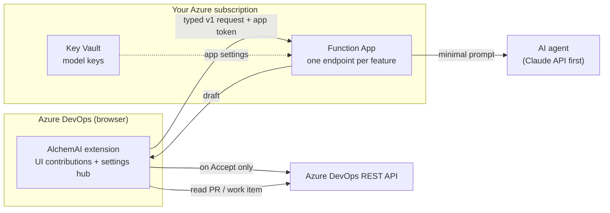
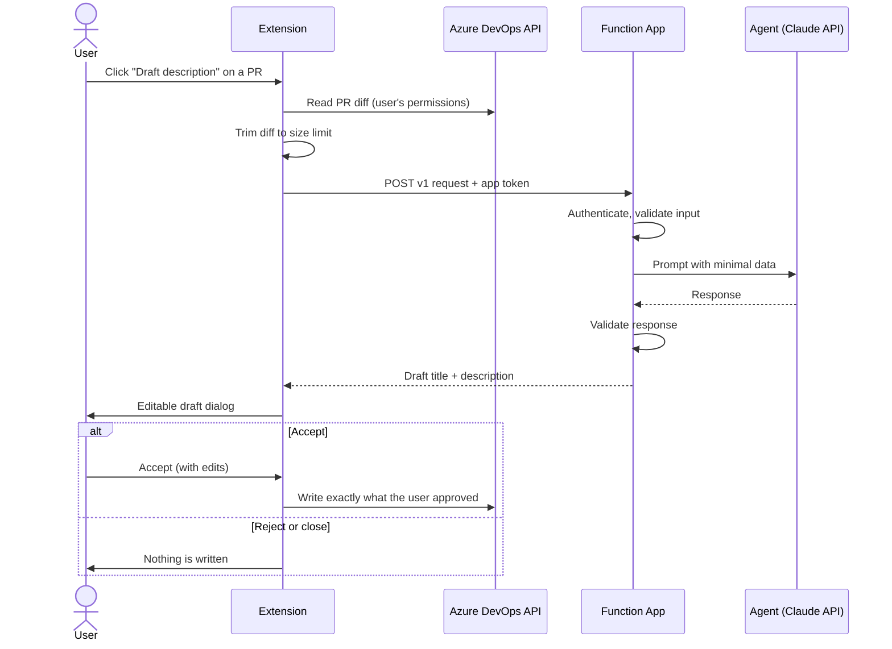

# Architecture

AlchemAI has three parts: an Azure DevOps **extension** that runs in the browser, a self-hosted **backend** (Azure Function App) that talks to AI agents, and a shared **contracts** package that defines what they send each other.



## Components

| Component | Runs in | Responsibility | Details |
| --- | --- | --- | --- |
| Extension | Azure DevOps (iframe in the browser) | Buttons and dialogs in Repos and Boards, reads the PR or work item, shows the editable draft, writes on Accept, admin settings hub | [Extension](Extension) |
| Backend | Azure Function App (Node.js, TypeScript) | Authenticates the caller, validates input, builds the prompt, calls the agent through an adapter, validates and returns the draft | [Backend](Backend) |
| Contracts | Shared TypeScript package | Typed, versioned request and response shapes used by both sides | [Contracts](Contracts) |
| Agent adapter | Inside the backend | Hides the AI provider behind one interface; Claude API first, others later | [Backend](Backend#agent-adapters) |

## Request flow: drafting a PR description



The same pattern applies to every feature: read in the extension, draft in the backend, write only from the extension after the user accepts.

## Design rules

- **One endpoint per feature**, versioned (`/api/v1/...`), so features can evolve independently.
- **Feature code never imports an agent SDK.** It depends only on the agent adapter interface; adding a provider means adding an adapter and configuration.
- **The backend persists nothing** beyond the request: no prompts, diffs, logs of content or model responses.
- **`backend` and `extension` never import each other.** Both depend only on `contracts`; lint enforces this.
- **Breaking contract changes require a major version** of both extension and backend.

## Repository layout

```text
packages/
├── contracts/   # shared typed contracts (CONTRACT_VERSION)
├── backend/     # Azure Function App
└── extension/   # Azure DevOps extension
docs/wiki/       # this wiki (synced on merge to main)
specs/           # Spec Kit feature specs, plans and tasks
.github/         # CI, CodeQL, Dependabot, wiki sync
```
