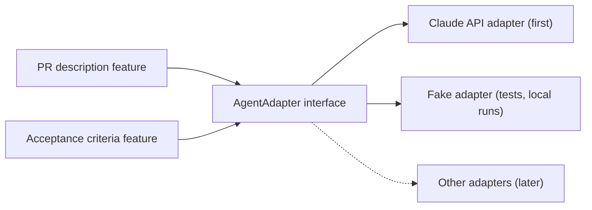

# Backend

> **Status:** package skeleton exists (`packages/backend`); the Function App, endpoints and adapters are planned in [#4](https://github.com/lu-creative-tech/oss-alchemai-azure-devops/issues/4) and [#5](https://github.com/lu-creative-tech/oss-alchemai-azure-devops/issues/5).

The backend is an Azure Function App (Node.js active LTS, TypeScript) that **you deploy in your own Azure subscription**. It is the only part of AlchemAI that talks to an AI provider and the only place model keys exist.

## Endpoints

| Endpoint | Auth | Purpose |
| --- | --- | --- |
| `GET /api/v1/health` | none | Reachability check used by **Test connection** |
| `GET /api/v1/ping` | required | Confirms authentication works end to end |
| One `POST /api/v1/...` per feature | required | Returns a draft for that feature (PR description, acceptance criteria, ...) |

Each feature endpoint:

1. **Authenticates** the caller with the configured authentication type. The first type validates the Azure DevOps app token issued to the extension.
2. **Validates** the request against the [contract](Contracts): type, size and format.
3. **Reads settings** that shape output (style, language, extra instructions) server-side.
4. **Builds the prompt** with only the data the feature needs.
5. **Calls the agent** through the agent adapter.
6. **Validates the response** before returning it as a draft.
7. **Returns** a typed response. Errors never expose internal details, keys or stack traces.

Nothing from the request (prompts, diffs, responses) is stored after the request ends.

## Agent adapters

Feature code depends only on an `AgentAdapter` interface, never on a provider SDK.

- **Claude API adapter:** the first real adapter; its key is read from app settings backed by Key Vault.
- **Fake adapter:** returns fixed drafts; used by all automated tests and for local runs without keys.
- **Adding a provider:** implement the interface, add configuration; no feature code changes.

## Configuration source

In Azure, secrets come from Function App settings backed by Key Vault. Locally they come from a git-ignored `.env` file (see [Development](Development)). Keys are never sent to the browser.
